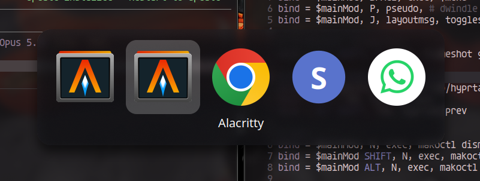

# hyprtab

<p align="center"></p>

Alt+Tab inspirado no do macOS para o Hyprland, em **um único plugin `.so`** (C++). Pensado para **0.52 até 0.57+**; só a 0.57 foi compilada até agora (veja [Status](#status)).

- Alt+Tab / Alt+Shift+Tab alternam entre as janelas por uso recente (MRU).
- Barra central com os ícones dos apps, desenhada pelo próprio compositor.
- Soltar o Alt confirma.

No mesmo repositório, com o mesmo visual:

- **[hyprdock](dock/README.md)**: dock inspirada na do macOS.
- **[hyprmenu](menubar/README.md)**: barra de menus global inspirada na do macOS, com os menus do app em foco.
- **[hyprpager](pager/README.md)**: pager de workspaces no estilo dos temas metálicos clássicos do Enlightenment.
- **[hyprfind](find/README.md)**: busca rápida inspirada no Spotlight (apps, janelas abertas, arquivos e contas).

## Teclas e mouse (com o switcher aberto)

| Ação | Efeito |
|---|---|
| `Tab` / `Shift+Tab` | avança / volta a seleção |
| `←` / `→` | move a seleção |
| segurar `Tab`, `←` ou `→` | repete o movimento enquanto a tecla estiver presa |
| `Enter` ou soltar `Alt` | confirma |
| `Esc` | cancela |
| mover o mouse sobre um ícone | seleciona (só depois que o mouse realmente se mexe; a barra costuma abrir debaixo do cursor) |
| clique esquerdo num ícone | confirma aquele app |
| clique fora da barra | cancela |

## Instalação

Dependências de build: headers do Hyprland (`hyprland`), `pango`, `cairo`, `pixman`, `libdrm`. Opcional: `librsvg` (ícones SVG; detectado sozinho pelo `Makefile`).

```sh
make
```

Gera `hyprtab.so`. Sem `librsvg`, só ícones PNG funcionam; sem ícone aparece um círculo com a inicial do app.

### Config hyprlang (`hyprland.conf`, até 0.56)

```ini
plugin = /caminho/para/hyprtab.so
bind = ALT, TAB, hyprtab:next
bind = ALT SHIFT, TAB, hyprtab:prev
```

### Config Lua (`hyprland.lua`, 0.57+)

```lua
hl.plugin.load("/caminho/para/hyprtab.so")
hl.bind("ALT + TAB",         function() hl.plugin.hyprtab.next() end)
hl.bind("ALT + SHIFT + TAB", function() hl.plugin.hyprtab.prev() end)
```

Também funciona via `hyprctl plugin load /caminho/para/hyprtab.so` ou `hyprpm`.

### Janelas fora do Alt+Tab

Janelas auxiliares ficam de fora por padrão (seletor de compartilhar tela, portais `xdg-desktop-portal*`, agentes de polkit, diálogos do Hyprland). Para acrescentar outras classes (`*` no começo/fim é curinga):

```ini
plugin {
    hyprtab {
        ignore = steam_app_*, outra-classe
    }
}
```

## Compatibilidade por versão

A API de plugins do Hyprland mudou bastante entre 0.52 e 0.57. As diferenças são detectadas em tempo de compilação (`src/compat.hpp`) e isoladas em poucas funções.

| Hyprland   | Eventos                   | Dispatchers                   | Render                                |
|------------|---------------------------|-------------------------------|---------------------------------------|
| 0.52–0.53  | `registerCallbackDynamic` | `addDispatcherV2`             | `CTexture`, `renderRect(box, …)`      |
| 0.54       | `Event::bus()`            | `addDispatcherV2`             | `CTexture`, `renderRect(box, …)`      |
| 0.55–0.56  | `Event::bus()`            | `addDispatcherV2` (+ Lua)     | `ITexture` + `createTexture(cairo)`   |
| 0.57+      | `Event::bus()`            | `addLuaFunction` (config Lua) | `renderRect(ctx, box, …)`             |

Na 0.57+ `hyprctl dispatch` aceita expressões Lua; o foco tenta o formato legado e depois o Lua. Classe e título das janelas vêm de `hyprctl clients -j`, que é estável entre versões.

## Estrutura

- `src/main.cpp`: MRU, teclado, mouse, dispatchers e foco.
- `src/ui.cpp`: barra do switcher (usa `render.cpp`).
- `src/icons.cpp`: classe da janela → `.desktop` → arquivo de ícone → surface cairo; também nome e `Exec=` do `.desktop` (sem dependência do Hyprland).
- `src/compat.hpp`: detecção da era do Hyprland e helpers comuns (foco, dispatch, lista de janelas).
- `src/render.cpp`: desenho no compositor (texturas, painel de vidro, hook de render por versão), usado também pela dock.
- `src/clients.cpp`: parser da saída de `hyprctl clients -j` (sem dependência do Hyprland).
- `src/layout.cpp`: geometria da barra e hit-test em px lógicos (sem dependência do Hyprland).
- `tests/test.cpp`: testes do parser e do layout, com ASan/UBSan: `make test`.
- `dock/`: o hyprdock (ver [dock/README.md](dock/README.md)).

## Status

- [x] Compila contra os headers reais do Hyprland 0.57.2
- [x] Compila e roda no Hyprland 0.53.3 (Ubuntu 26.04)
- [ ] 0.52, 0.54 – 0.56: o código tem ramos para elas (lidos dos headers), mas **nunca foram compilados**

## Feito com IA

Este projeto foi desenvolvido com a ajuda de IA ([Claude Code](https://claude.com/claude-code)): código, correções, testes e documentação foram escritos em conjunto com o assistente e revisados e testados por um humano num Hyprland de verdade.

## Licença

[MIT](LICENSE)

## Marcas

macOS, OS X e Spotlight são marcas registradas da Apple Inc., citadas aqui só para descrever a inspiração. Este projeto não tem afiliação com a Apple nem é endossado por ela, e não usa código, ícones, fontes ou outros recursos da Apple.
