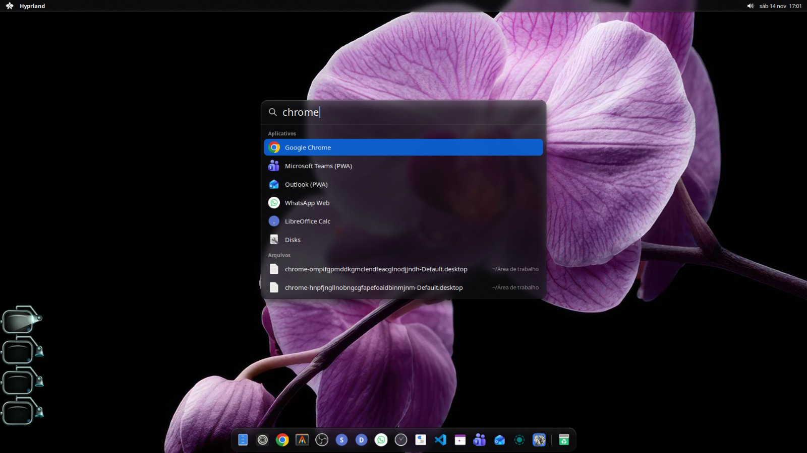
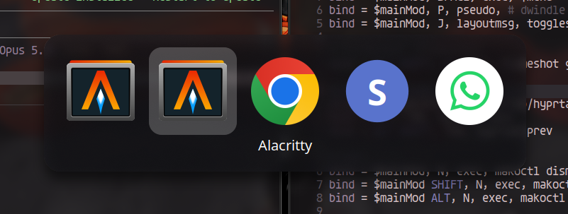

# hyprtab

<p align="center"></p>

Conjunto de plugins para o Hyprland, todos em C++ (um `.so` por plugin) e com o mesmo visual de vidro: switcher de janelas, dock, barra de menus, pager de workspaces, busca e bordas. O primeiro foi o **hyprtab**, um Alt+Tab inspirado no do macOS. Pensado para **0.52 até 0.57+**; só a 0.53 e a 0.57 foram compiladas (veja [Status](#status)).

## Plugins

Cada plugin é um `.so` independente, com o mesmo visual de vidro. Carregue só os que quiser.

| Plugin | O que faz | Pasta | Atalho / dispatcher |
|---|---|---|---|
| **hyprtab** | Alt+Tab com ícones dos apps, por uso recente (MRU) | [`plugins/hyprtab`](#hyprtab) | `hyprtab:next`, `hyprtab:prev` |
| **hyprdock** | dock inspirada na do macOS, com zoom nos ícones | [`plugins/dock`](plugins/dock/README.md) | `hyprdock:menu` |
| **hyprmenu** | barra de menus global, com os menus do app em foco | [`plugins/menubar`](plugins/menubar/README.md) | `hyprmenu:open` |
| **hyprpager** | pager de workspaces no estilo dos temas metálicos do Enlightenment | [`plugins/pager`](plugins/pager/README.md) | (sem atalho) |
| **hyprfind** | busca rápida inspirada no Spotlight (apps, janelas, arquivos, contas, calculadora) | [`plugins/find`](plugins/find/README.md) | `hyprfind:toggle` |
| **hyprborders** | bordas e sombras das janelas | `plugins/borders` | (sem atalho) |

> O `hyprborders` compila no 0.53 e no 0.57, mas no 0.57 **nunca rodou num Hyprland de verdade** (a curva da sombra usa o `decoration:shadow:render_power` do Hyprland). O código comum entre os plugins está em `common/`; o tema de cursor, em `themes/cursors`.

## Instalação

Dependências de build: headers do Hyprland (`hyprland`), `pango`, `cairo`, `pixman`, `libdrm`. Opcional: `librsvg` (ícones SVG; detectado sozinho pelos `Makefile`). O hyprmenu também precisa de `libsystemd` e o hyprfind, de `libxkbcommon`.

```sh
make                    # compila hyprtab, dock, menubar, pager, find e borders
make test               # roda os testes de todos
make -C plugins/dock    # ou só um plugin
```

Os `.so` saem em `plugins/<nome>/`:

| Plugin | Arquivo |
|---|---|
| hyprtab | `plugins/hyprtab/hyprtab.so` |
| hyprdock | `plugins/dock/hyprdock.so` |
| hyprmenu | `plugins/menubar/hyprmenu.so` |
| hyprpager | `plugins/pager/hyprpager.so` |
| hyprfind | `plugins/find/hyprfind.so` |
| hyprborders | `plugins/borders/hyprborders.so` |

Sem `librsvg`, só ícones PNG funcionam; sem ícone aparece um círculo com a inicial do app. Também dá para carregar com `hyprctl plugin load /caminho/para/x.so` ou `hyprpm`.

## Exemplo de config

### hyprlang (`hyprland.conf`, até 0.56)

```ini
# --- plugins (ajuste o caminho) ---
plugin = /caminho/para/hyprtab/plugins/hyprtab/hyprtab.so
plugin = /caminho/para/hyprtab/plugins/dock/hyprdock.so
plugin = /caminho/para/hyprtab/plugins/menubar/hyprmenu.so
plugin = /caminho/para/hyprtab/plugins/pager/hyprpager.so
plugin = /caminho/para/hyprtab/plugins/find/hyprfind.so
plugin = /caminho/para/hyprtab/plugins/borders/hyprborders.so

# --- atalhos ---
bind = ALT,       TAB,   hyprtab:next
bind = ALT SHIFT, TAB,   hyprtab:prev
bind = SUPER,     SPACE, hyprfind:toggle
bind = ALT,       F10,   hyprmenu:open
bind = SUPER,     D,     hyprdock:menu

# o hyprborders desenha a borda e a sombra: desligue as nativas
general { border_size = 0 }
decoration { shadow { enabled = false } }

# --- opções (todas opcionais; estes são exemplos) ---
plugin {
    hyprtab {
        ignore = steam_app_*, outra-classe           # classes fora do Alt+Tab; `*` no começo/fim
    }
    hyprdock {
        apps = org.gnome.Nautilus, google-chrome     # apps fixos (classe ou nome do .desktop)
        icon_size = 48
        magnification = 1.6                          # zoom sob o mouse; 1 desliga
        position = bottom                            # bottom, left ou right
        reserve = 1                                  # 0: fica por cima das janelas
    }
    hyprmenu {
        height = 28
        clock = 1
        volume = 1
        lock_command = hyprlock
    }
    hyprpager {
        workspaces = 4
        position = left                              # left ou right
        align = center                               # top, center ou bottom
        margin = 12
    }
    hyprfind {
        width = 680
        files = 1                                    # 0: sem a seção de arquivos
        fzf = auto                                   # auto, off ou o caminho do executável
    }
    hyprborders {
        shadow = 1                                   # 0 desliga a sombra
        shadow_blur = 70
        shadow_alpha = 0.56
        border = 1                                   # 0 desliga o contorno
    }
}
```

Todas as opções de cada plugin estão no README dele.

### Lua (`hyprland.lua`, 0.57+)

```lua
hl.plugin.load("/caminho/para/hyprtab/plugins/hyprtab/hyprtab.so")
hl.plugin.load("/caminho/para/hyprtab/plugins/dock/hyprdock.so")
hl.plugin.load("/caminho/para/hyprtab/plugins/menubar/hyprmenu.so")
hl.plugin.load("/caminho/para/hyprtab/plugins/pager/hyprpager.so")
hl.plugin.load("/caminho/para/hyprtab/plugins/find/hyprfind.so")

hl.bind("ALT + TAB",         function() hl.plugin.hyprtab.next() end)
hl.bind("ALT + SHIFT + TAB", function() hl.plugin.hyprtab.prev() end)
hl.bind("SUPER + SPACE",     function() hl.plugin.hyprfind.toggle() end)
hl.bind("ALT + F10",         function() hl.plugin.hyprmenu.open() end)

hl.config({
    plugin = {
        hyprpager = { workspaces = 6, position = "right", align = "top" },
    },
})
```

Na 0.57 (config em Lua) o hyprdock e o hyprmenu ainda não leem as opções e usam os valores padrão; a reserva de espaço também não funciona lá (ficam por cima das janelas).

## hyprtab

<p align="center"></p>

Alt+Tab inspirado no do macOS: alterna entre as janelas por uso recente (MRU), com uma barra central de ícones desenhada pelo próprio compositor. Soltar o Alt confirma.

### Teclas e mouse (com o switcher aberto)

| Ação | Efeito |
|---|---|
| `Tab` / `Shift+Tab` | avança / volta a seleção |
| `←` / `→` | move a seleção |
| segurar `Tab`, `←` ou `→` | repete o movimento enquanto a tecla estiver presa |
| `Enter` ou soltar `Alt` | confirma |
| `Esc` | cancela |
| mover o mouse sobre um ícone | seleciona (só depois que o mouse realmente se mexe; a barra costuma abrir debaixo do cursor) |
| clique esquerdo num ícone | confirma aquele app |
| clique fora da barra | cancela |

### Janelas fora do Alt+Tab

Janelas auxiliares ficam de fora por padrão (seletor de compartilhar tela, portais `xdg-desktop-portal*`, agentes de polkit, diálogos do Hyprland). Para acrescentar outras classes (`*` no começo/fim é curinga):

```ini
plugin {
    hyprtab {
        ignore = steam_app_*, outra-classe
    }
}
```

## Compatibilidade por versão

A API de plugins do Hyprland mudou bastante entre 0.52 e 0.57. As diferenças são detectadas em tempo de compilação (`common/compat.hpp`) e isoladas em poucas funções.

| Hyprland   | Eventos                   | Dispatchers                   | Render                                |
|------------|---------------------------|-------------------------------|---------------------------------------|
| 0.52–0.53  | `registerCallbackDynamic` | `addDispatcherV2`             | `CTexture`, `renderRect(box, …)`      |
| 0.54       | `Event::bus()`            | `addDispatcherV2`             | `CTexture`, `renderRect(box, …)`      |
| 0.55–0.56  | `Event::bus()`            | `addDispatcherV2` (+ Lua)     | `ITexture` + `createTexture(cairo)`   |
| 0.57+      | `Event::bus()`            | `addLuaFunction` (config Lua) | `renderRect(ctx, box, …)`             |

Na 0.57+ `hyprctl dispatch` aceita expressões Lua; o foco tenta o formato legado e depois o Lua. Classe e título das janelas vêm de `hyprctl clients -j`, que é estável entre versões.


## Status

- [x] Compila contra os headers reais do Hyprland 0.57.2
- [x] Compila e roda no Hyprland 0.53.3 (Ubuntu 26.04)
- [ ] 0.52, 0.54 – 0.56: o código tem ramos para elas (lidos dos headers), mas **nunca foram compilados**

## Feito com IA

Este projeto foi desenvolvido com a ajuda de IA ([Claude Code](https://claude.com/claude-code)): código, correções, testes e documentação foram escritos em conjunto com o assistente e revisados e testados por um humano num Hyprland de verdade.

## Licença

[MIT](LICENSE)

## Marcas

macOS, OS X e Spotlight são marcas registradas da Apple Inc., citadas aqui só para descrever a inspiração. Este projeto não tem afiliação com a Apple nem é endossado por ela, e não usa código, ícones, fontes ou outros recursos da Apple.
